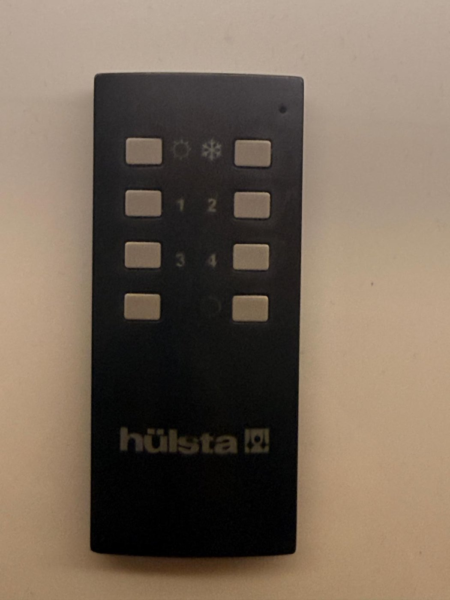
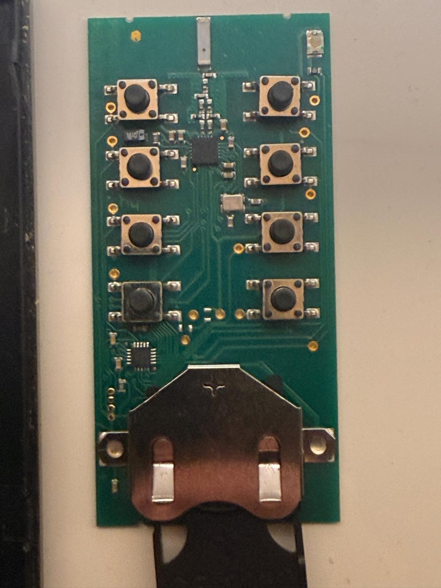

[](README.md)
[](README.de.md)

# ESPHome ↔ L&S Emotion „Bielefeld“ (CC2500)

Steuere die **ältere L&S-Emotion-Beleuchtung mit der Steuerung „Bielefeld“** – wie sie z. B. in
Hülsta-Möbeln verbaut ist – aus ioBroker, Home Assistant oder jedem anderen System, das mit
ESPHome spricht. Kein Gateway, keine Eingriffe an Fernbedienung oder Steuerung: Ein ESP32 mit
einem **CC2500**-Funkmodul (2,4 GHz) spricht das Protokoll der Fernbedienung.

Die neuere Serie **„Frankfurt“** funkt mit einem anderen Protokoll und wird von
[SergeyZh/emotion-control-ha](https://github.com/SergeyZh/emotion-control-ha) abgedeckt. Dieses
Projekt ist daraus entstanden und dokumentiert das dazu nicht kompatible Bielefeld-Protokoll.

**Status: funktioniert**, getestet mit einer 8-Tasten-Fernbedienung (Platine `TxD8 LUS_RC24`,
2016) und einer „Emotion 4-Kanal Steuerung Bielefeld 12/24 V“ mit drei angeschlossenen Lampen.

## Funktionen

- **Lampen als dimmbare Lichter:** jeder Kanal (1–4) erscheint als Licht mit Ein/Aus und Helligkeit.
- **Farbtemperatur** aller Lampen als Zahl 0–100 % (0 = am kältesten, 100 = am wärmsten).
- **Alle Ein / Alle Aus, Wärmer / Kälter** als Buttons.
- **Dimmen:** Buttons, die eine Taste eine einstellbare Zeit „halten“, auch für mehrere Kanäle gleichzeitig.
- **Abgleich mit der Fernbedienung:** Tastendrücke der echten Fernbedienung werden empfangen, die
  Lampenzustände ziehen nach, und die gedrückte Taste erscheint als Text-Sensor.
- **Suchmodus:** Ohne eingetragene ID lauscht die Komponente nur und schreibt die ID jeder
  gehörten Fernbedienung ins Log.
- **Diagnose-Werkzeuge**, mit denen das Protokoll gefunden wurde: ein 2,4-GHz-Spektrumscanner und
  ein Mitschnitt, der das Sync-Wort nicht kennen muss ([docs/TOOLS.de.md](docs/TOOLS.de.md)).

## Welche Fernbedienung habe ich?

| | Bielefeld (dieses Projekt) | Frankfurt ([emotion-control-ha](https://github.com/SergeyZh/emotion-control-ha)) |
|---|---|---|
| Fernbedienung | 8 Tasten: Sonne, Schneeflocke, 1–4, Ein (\|), Aus (O) | Drehrad bzw. 3 Tasten |
| Funk | 2433,0 MHz, 2-FSK, ca. 10 kBaud | 2436,2 MHz, MSK, 250 kBaud |
| Mikrocontroller in der Fernbedienung | STM8L101 | PIC16F1503 |




Weitere Fotos der Fernbedienung und ihrer Platine: [docs/PROTOCOL.de.md](docs/PROTOCOL.de.md#hardware-der-fernbedienung).

Unsicher? Den [Spektrumscanner](docs/TOOLS.de.md) flashen und eine Taste drücken: Bielefeld
taucht um 2433 MHz auf.

## Was du brauchst

| Teil | Hinweise |
|---|---|
| **ESP32** | beliebiges Board; getestet mit einem ESP32 DevKit (ESP-WROOM-32) |
| **CC2500-Modul** | 2,4 GHz, **26-MHz-Quarz**. Module mit 2×5-Stiftleiste (2,54 mm) brauchen keine Lötarbeiten |
| **Deine L&S-Fernbedienung** | ihre ID übernimmt der ESP32 (er tritt als zweites Exemplar deiner Fernbedienung auf) |

Das Modul **nur mit 3,3 V** versorgen.

### Verkabelung (CC2500-Modul → ESP32)

| Modul | Signal | ESP32 |
|---|---|---|
| SCLK | SPI-Takt | GPIO18 |
| SI | MOSI | GPIO23 |
| SO | MISO | GPIO19 |
| CSN | Chip Select | GPIO5 |
| VCC / GND | Versorgung | 3V3 / GND |

GDO0 und GDO2 werden nicht benötigt.

## Schnellstart

1. Den Ordner `components/` neben deine ESPHome-YAML kopieren.
2. **ID der Fernbedienung finden:** [`examples/find-remote-id.yaml`](examples/find-remote-id.yaml)
   flashen, eine Taste drücken und im Log nach
   `Remote found - remote_id: 12 34 56 78 9A BC DE F0: Ein (counter 530, -46 dBm)` suchen.
3. Diese ID in [`examples/bielefeld.yaml`](examples/bielefeld.yaml) (native API, z. B. Home
   Assistant / ioBroker-ESPHome-Adapter) oder [`examples/bielefeld-mqtt.yaml`](examples/bielefeld-mqtt.yaml)
   (MQTT, z. B. ioBroker-MQTT-Adapter) eintragen und flashen.
4. Nach dem Flashen einmal **„Alle Aus“** drücken, damit der ESP32 die Lampenzustände kennt.

## Minimale Konfiguration

```yaml
external_components:
  - source: github://fewall/emotion-control-bielefeld
    components: [ls_bielefeld]

spi:
  clk_pin: GPIO18
  mosi_pin: GPIO23
  miso_pin: GPIO19

ls_bielefeld:
  cs_pin: GPIO5
  remote_id: "12 34 56 78 9A BC DE F0"   # ID deiner Fernbedienung

light:
  - platform: ls_bielefeld
    name: "Schrank Kanal 1"
    channel: 1

number:
  - platform: ls_bielefeld
    name: "Farbtemperatur"

button:
  - platform: ls_bielefeld
    name: "Alle Aus"
    key: aus
  - platform: ls_bielefeld
    name: "Kanal 1 dimmen"
    key: kanal_1
    hold: 2s
```

### Optionen

| Block | Option | Standard | Bedeutung |
|---|---|---|---|
| `ls_bielefeld` | `remote_id` | – | 8-Byte-ID der Fernbedienung. Ohne: nur lauschen, IDs ins Log |
| | `frequency` | `2433.0MHz` | Trägerfrequenz |
| | `deviation` | `38kHz` | Frequenzhub beim Senden |
| | `repeats` | `6` | Wiederholungen jedes Pakets |
| | `dim_time` | `1000ms` | Zeit der Steuerung von maximaler bis minimaler Helligkeit bei gehaltener Kanaltaste |
| | `color_time` | `1200ms` | dasselbe für die Farbtemperatur, von kalt bis warm |
| `light` | `channel` | – | Lampenkanal 1–4 |
| `number` | – | – | Farbtemperatur aller Lampen, 0–100 % |
| `button` | `key` | – | `sonne`, `schneeflocke`, `kanal_1` … `kanal_4`, `ein`, `aus` oder eine Liste gleichzeitig gedrückter Tasten |
| | `hold` | `0ms` | 0 = kurz drücken, sonst Haltedauer (max. 10 s) |
| `text_sensor` | – | – | aktuell auf der echten Fernbedienung gedrückte Taste, leer nach dem Loslassen |

## So verhält sich die Steuerung

- **Kanaltaste kurz:** schaltet diese Lampe um. **Gehalten:** dimmt; die Richtung wechselt bei jedem
  Halten. Es geht ca. 0,5 s nach dem Drücken los, der ganze Bereich dauert dann ca. 1 s. An beiden
  Enden bleibt die Helligkeit kurz stehen (oben ≈3 s, unten ≈1 s) und kehrt dann um. Die Lampen
  behalten eine Mindesthelligkeit und merken sich die Helligkeit beim Ausschalten.
- **Ein / Aus:** immer alle Lampen.
- **Sonne / Schneeflocke:** Lichtfarbe aller Lampen; gehalten immer wärmer bzw. kälter bis zum
  Anschlag (keine Umkehr).
- Die Steuerung prüft den Zähler **nicht streng**: Nachdem der ESP32 gesendet hat, funktioniert die
  echte Fernbedienung weiter.

## Einschränkungen

- **Keine Rückmeldung von der Steuerung.** Die Lampenzustände sind eine Schätzung aus allem, was der
  ESP32 sendet und empfängt. Stimmt sie nicht (Stromausfall, verpasstes Paket), gleicht „Alle Aus“ sie ab.
- **Auch Helligkeit und Farbtemperatur sind Schätzungen.** Ein neuer Wert wird durch Halten einer
  Taste für eine berechnete Zeit erreicht; die Komponente merkt sich die wechselnde Dimmrichtung.
  Ginge das nächste Halten in die falsche Richtung, fährt sie erst an den Anschlag. 100 % / 1 %
  (bzw. 0 % / 100 % Farbe) fahren immer an den Anschlag und gleichen die Schätzung ab. Passen die
  Werte nicht, `dim_time` / `color_time` anpassen.
- Der Sendehub (38 kHz) ist TIs SmartRF-Standardwert für 10 kBaud und funktioniert hier, wurde an der
  Original-Fernbedienung aber nicht gemessen.

## Dokumentation

| Dokument | Inhalt |
|---|---|
| [docs/PROTOCOL.de.md](docs/PROTOCOL.de.md) | Funkparameter, Paketformat, Tasten, Zähler, Halte-Ablauf |
| [docs/TOOLS.de.md](docs/TOOLS.de.md) | Spektrumscanner, Mitschnitt, Decoder – wie das Protokoll gefunden wurde |

## Danksagung

- [SergeyZh/emotion-control-ha](https://github.com/SergeyZh/emotion-control-ha) und
  [emotion-control-re](https://github.com/SergeyZh/emotion-control-re) – das Frankfurt-Protokoll, der
  Aufbau des CC2500-Treibers und die Idee, die das hier möglich gemacht hat.

## Lizenz

[Apache License 2.0](LICENSE).

Dieses Projekt steht in keiner Verbindung zu L&S Deutschland GmbH oder Hülsta und wird von ihnen
nicht unterstützt. „Emotion“, „L&S“ und „Hülsta“ sind Marken ihrer Inhaber und werden nur zur
Angabe der Kompatibilität genannt.
