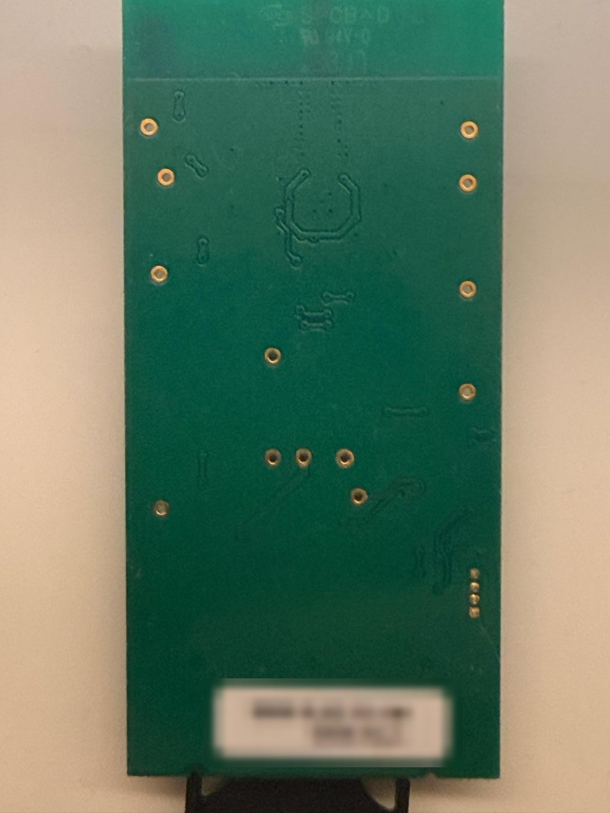
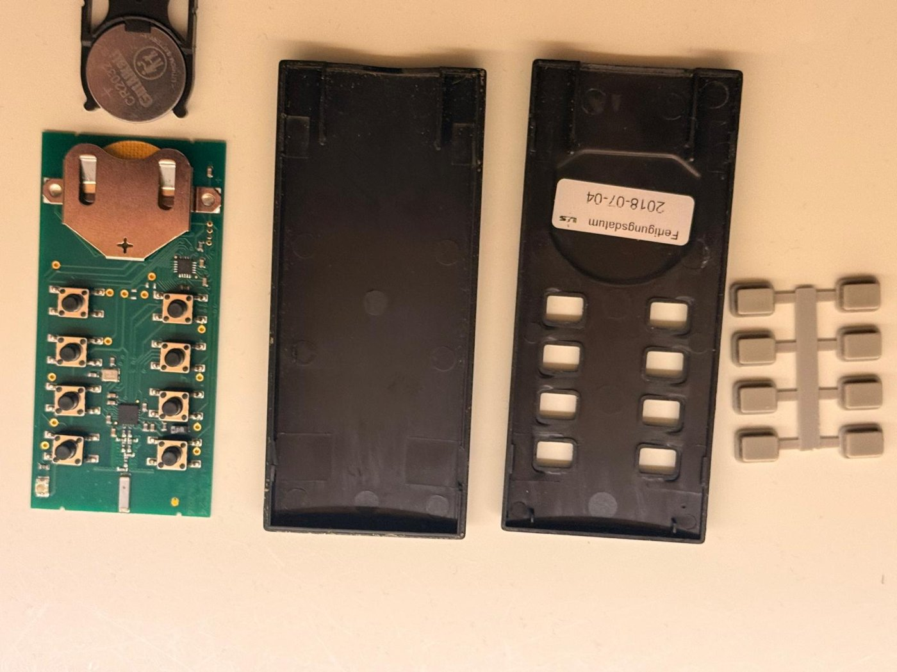
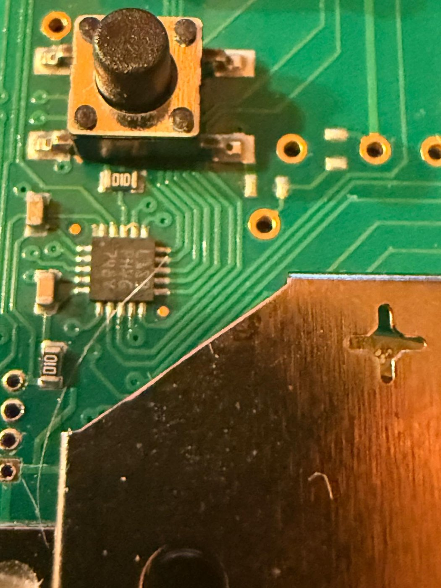
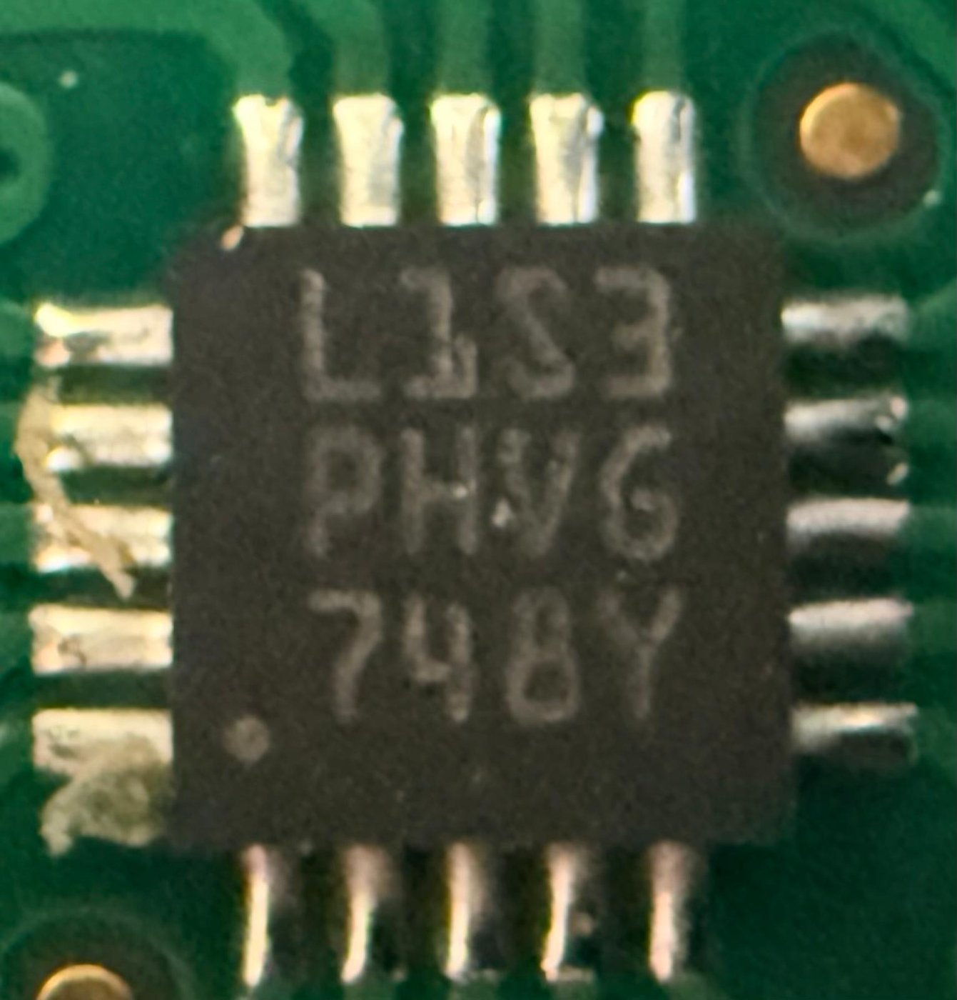

[](PROTOCOL.md)
[](PROTOCOL.de.md)

# L&S Emotion "Bielefeld" radio protocol

Determined by listening only – the remote's firmware was **not** read (see
[How it was found](#how-it-was-found)). Everything below was verified against 420 captured
frames; 419 of them passed the CC2500 hardware CRC.

## Hardware of the remote

| Part | Notes |
|---|---|
| PCB | marking `TxD8 LUS_RC24`, `26.04.2016`, `V11` |
| MCU | STMicroelectronics **STM8L101F3U6** (UFQFPN20, marking `L1S3`) |
| Radio | TI **CC2500**, 26 MHz crystal, ceramic chip antenna |
| Programming pads | 4 holes, 1.27 mm pitch, next to the MCU: VDD, SWIM, GND, NRST (square pad = VDD) |
| Battery | CR2032 |

| | | |
|---|---|---|
| <br>Remote | <br>PCB, component side | <br>PCB, back |
| <br>Opened: PCB, battery holder, case, key mat | <br>STM8L101 and the 4 programming pads (left) | <br>MCU marking `L1S3` = STM8L101F3U6 |

## Radio parameters

| Parameter | Value |
|---|---|
| Carrier | **2433.0 MHz** (`FREQ = 0x5D93B1`, `CHANNR = 0`) |
| Modulation | **2-FSK** |
| Data rate | **~10 kBaud** (`DRATE_E = 8`, `DRATE_M = 0x93` → 9.99 kBaud) |
| Deviation | not measured; 38 kHz (`DEVIATN = 0x44`) is accepted by the control unit |
| Preamble | `0xAA…` (at least 4 bytes) |
| Sync word | **`D3 91`**, sent twice (`SYNC_MODE` 30/32 → `D3 91 D3 91` on air) |
| Packet | variable length, first byte = length = `0x0E` (14) |
| CRC | CC2500 hardware CRC-16 (poly `0x8005`, init `0xFFFF`) over length byte + payload |
| FEC / whitening | off |

These are, apart from the data rate preset, the defaults of TI's SmartRF Studio for the CC2500 –
including the 2433 MHz base frequency, which the newer Frankfurt series also uses.

Register set used by the `ls_bielefeld` component (26 MHz crystal):

| Reg | Name | Value | | Reg | Name | Value |
|---|---|---|---|---|---|---|
| 0x04 | SYNC1 | `D3` | | 0x10 | MDMCFG4 | `88` (RX BW 203 kHz) |
| 0x05 | SYNC0 | `91` | | 0x11 | MDMCFG3 | `93` |
| 0x06 | PKTLEN | `0E` | | 0x12 | MDMCFG2 | `03` (2-FSK, 30/32) |
| 0x07 | PKTCTRL1 | `0C` | | 0x13 | MDMCFG1 | `22` |
| 0x08 | PKTCTRL0 | `05` | | 0x15 | DEVIATN | `44` |
| 0x0B | FSCTRL1 | `08` | | 0x19 | FOCCFG | `16` |
| 0x0D–0x0F | FREQ | `5D 93 B1` | | 0x1A | BSCFG | `6C` |

## Frame format

On air: `preamble | D3 91 D3 91 | 0E | payload (14 bytes) | CRC (2 bytes)`

| Byte | Example | Meaning |
|---|---|---|
| 0 | `09` | constant (frame type) |
| 1 | `40` | **key bit mask** (see below), `00` = released |
| 2–3 | `02 12` | **counter**, 16 bit big-endian, +1 per key press |
| 4 | `00` | constant |
| 5 | `00` | **sequence** within one press: 0 = pressed, 1, 2, … while held, last = release |
| 6–13 | `12 34 56 78 9A BC DE F0` | **remote ID** (constant per remote) |

### Keys

| Bit | Key on the remote | ESPHome `key` |
|---|---|---|
| `01` | sun (warmer) | `sonne` |
| `02` | snowflake (colder) | `schneeflocke` |
| `04` | 1 | `kanal_1` |
| `08` | 2 | `kanal_2` |
| `10` | 3 | `kanal_3` |
| `20` | 4 | `kanal_4` |
| `40` | on (\|) | `ein` |
| `80` | off (O) | `aus` |

Several keys held together set several bits, e.g. `0C` = channel 1 + channel 2.

### Sequence of one key press

Short press of "on" (counter 530):

```
0E 09 40 02 12 00 00 12 34 56 78 9A BC DE F0 | 8E F4    pressed   (seq 0, repeated ~4-8x)
0E 09 00 02 12 00 01 12 34 56 78 9A BC DE F0 | E8 D5    released  (key 00, seq 1)
```

Channel 1 held for ~3 s (counter 516):

```
0E 09 04 02 04 00 00 …   seq 0  pressed
0E 09 04 02 04 00 01 …   seq 1  still held (~0.5 s later)
…                         seq 2 … 5, one step about every 0.5 s
0E 09 00 02 04 00 06 …   seq 6  released (key 00)
```

Every step is transmitted several times; one frame takes ~20 ms on air.

### Counter

The counter increases by one per key press and is kept by the remote. The control unit does **not**
reject frames with a lower counter: after the ESP32 (continuing from the remote's last counter)
has transmitted, the real remote keeps working although its counter is now behind. The component
nevertheless follows the remote's counter and stores it in flash.

## Behaviour of the control unit (4-channel Bielefeld)

| Action | Effect |
|---|---|
| channel key, short | toggles the lamp on that channel |
| channel key, held | dims that lamp; starts ~0.5 s after pressing (with the 2nd frame); direction alternates with every hold; full range ~1 s; stays ~3 s at max. / ~1 s at min., then reverses; a minimum brightness remains |
| several channel keys held | dims these lamps together |
| on / off | all lamps on / off; brightness is remembered |
| sun / snowflake, held | colour temperature of all lamps, always warmer / colder, stops at the end (no reversal); full range ~1.2 s |

## How it was found

1. **Sergey's Frankfurt component** heard nothing – not even rejected frames.
2. The remote was opened: CC2500 + STM8L101. Reading the firmware via SWIM failed
   (the debug interface did not respond), so a pure radio approach was taken.
3. A **spectrum scanner** (`cc2500_scanner`) showed a strong, repeating signal around **2433 MHz**
   while keys were pressed.
4. A **raw capture** (`cc2500_capture`) triggered on the preamble (`0xAAAAAAAA`, 30/32 bits) instead
   of a sync word and cycled through ten modulation / data-rate profiles. Only
   **"10 kBaud 2-FSK"** produced frames – hundreds of them, at −33 dBm, containing `D3 91 D3 91 0E`.
5. Realigning the captured bit stream on `D3 91 D3 91` ([tools/decode_capture.py](../tools/decode_capture.py))
   gave frames that passed the CC2500 CRC (419 of 420). Pressing the keys in a fixed order mapped the bits.

The tools are documented in [TOOLS.md](TOOLS.md) and may help with other variants.
